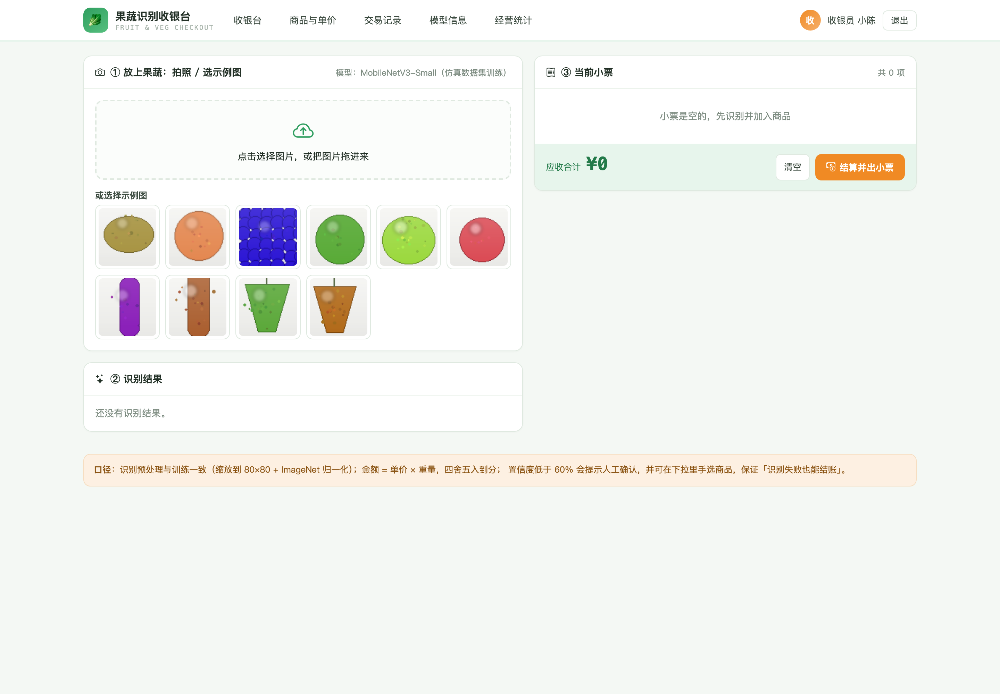
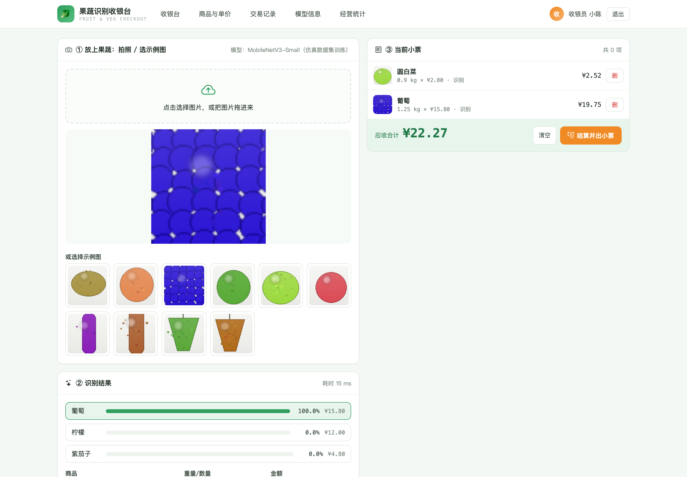
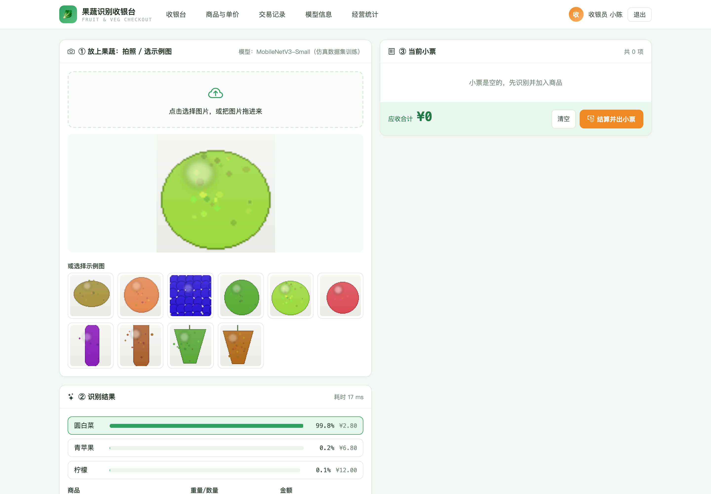
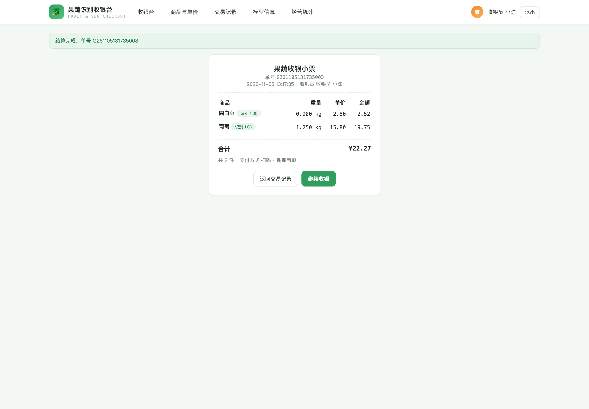
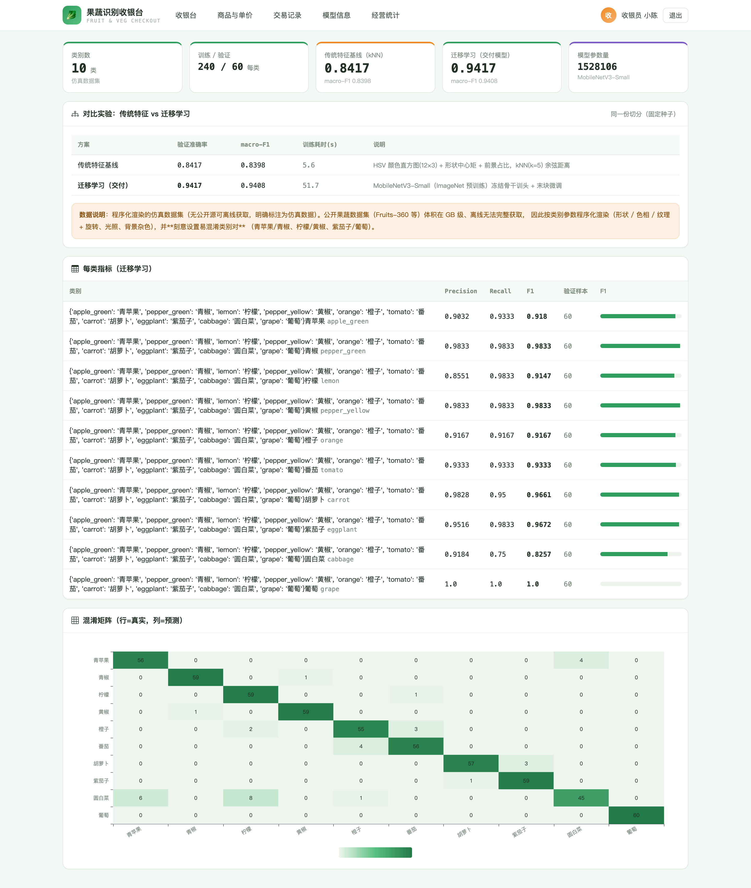
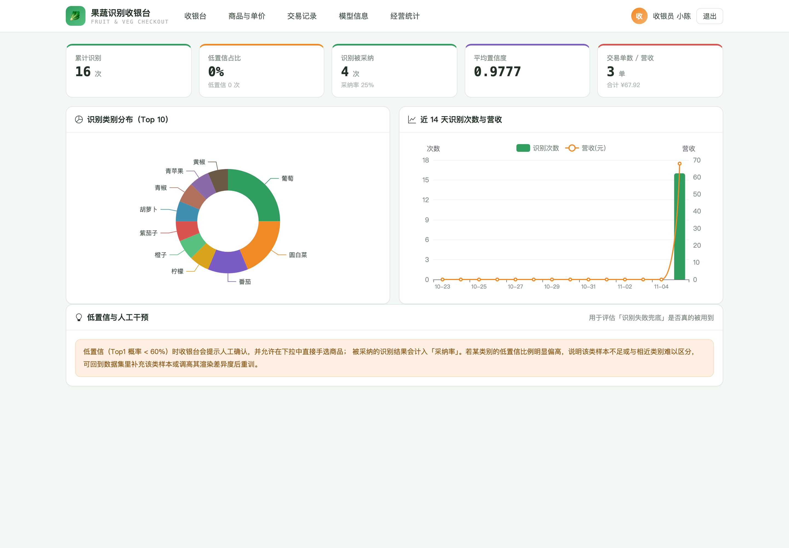
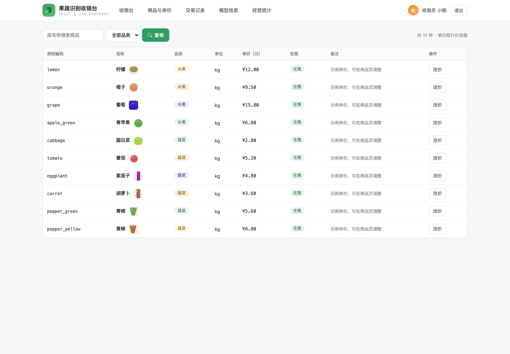
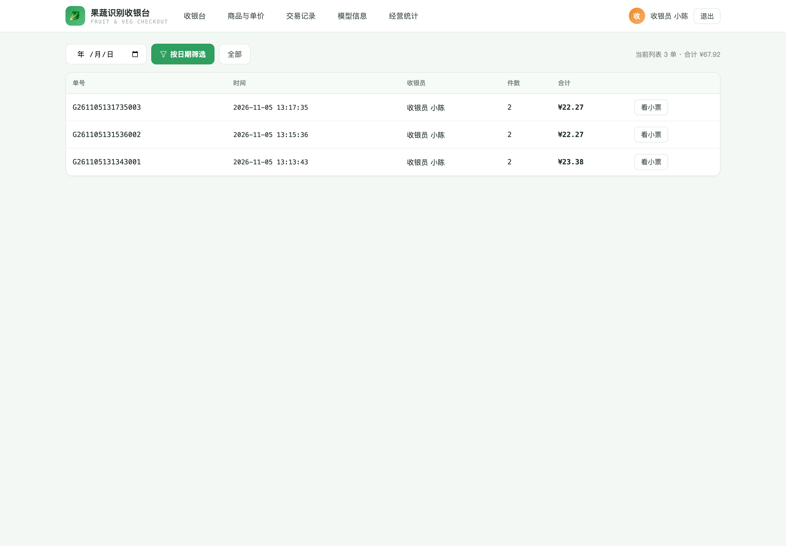
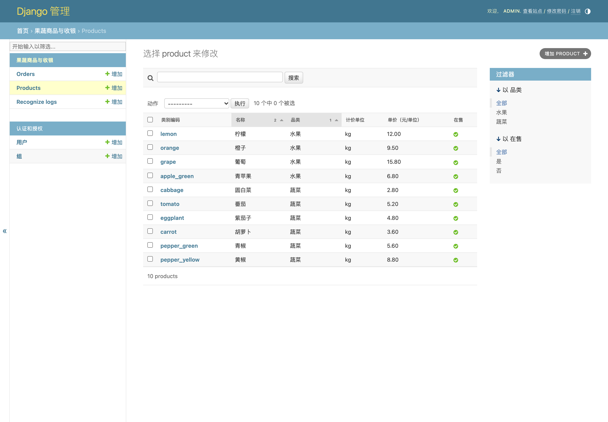
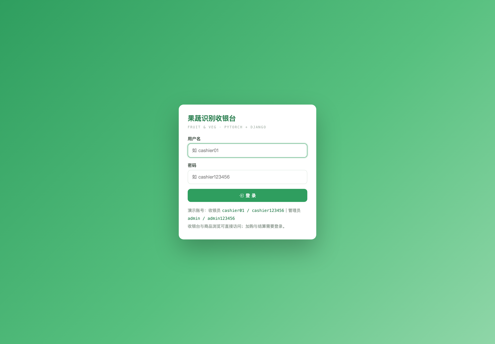

# 017 基于 PyTorch 的果蔬识别与计价系统-设计展示

> **代码有偿获取 可接受定制 微信联系方式: csbysj2020 或 ACE2487，备注(BS)**

> **完整源码与全套文档 · 在线自助获取 >>> [https://mbd.pub/o/bread/YZaWlZZqag==](https://mbd.pub/o/bread/YZaWlZZqag==)**

> **成品页（功能介绍 / 更多选题）>>> [https://bishe.suilang.net/products/pytorch-fruit-checkout](https://bishe.suilang.net/products/pytorch-fruit-checkout)**

> 

> 

## 视频

> **点击查看 >>> [https://www.bilibili.com/video/BV1Ng4t6sEff/](https://www.bilibili.com/video/BV1Ng4t6sEff/)**

## 项目简介

面向生鲜收银的果蔬识别与计价系统：拍照或选示例图识别果蔬类别，带出单价，输入重量即完成计价，结算生成订单与小票；识别不确定时提示人工确认并允许手选，保证识别失败也能正确结账。模型用 MobileNetV3-Small 迁移学习，并与传统特征基线做对比实验（84.17% → 94.17%）。

生鲜超市的散装果蔬没有条码，收银员必须凭经验判断品类与单价再称重计价，高峰期既慢又容易出错，而青椒与青苹果、柠檬与黄椒这类相近外观进一步放大了错误风险。

本项目设计并实现了一套基于 PyTorch 的果蔬识别与计价系统，把「识别 → 人工确认 → 称重 → 计价 → 小票 → 统计」串成完整闭环。

数据集方面，公开果蔬数据集（Fruits-360 等）体积在 GB 级、离线环境无法完整获取，因此本项目构建了程序化渲染的仿真数据集：按类别给出形状、色相、纹理与高光参数，叠加随机旋转、缩放、光照渐变与背景杂色，生成 80×80 图像，每类 240 张训练 + 60 张验证（10 类共 3000 张，固定种子 42 可复现），并刻意设置青苹果/青椒、柠檬/黄椒、紫茄子/葡萄三对易混淆类别。

本仓库为**设计展示**：包含项目说明、技术架构、实验结果与运行截图；完整源码、任务书、开题报告、毕业论文与使用说明可通过上方链接自助获取，成品页可查看更多选题，也可联系微信咨询定制。

## 功能特性

1. 对比实验：传统特征基线（HSV 直方图 + 形状中心矩 + kNN）84.17% vs 迁移学习（MobileNetV3-Small）94.17%，macro-F1 0.9408

2. 自建程序化渲染数据集：10 类 ×（240 训练 + 60 验证）= 3000 张 80×80，固定种子可复现，刻意设置三对易混淆类别

3. 误差分析：最弱类别圆白菜 F1 0.826（召回 0.750），混淆矩阵显示被误判为颜色相近的青苹果；同为绿色系的青椒 F1 0.983 说明学到了形状特征

4. 低置信兜底：Top1 概率低于 60% 提示人工确认，并可随时手选商品——识别失败也能结账

5. 收银台双栏：左栏识别（Top-3 概率条 + 自动带出单价），右栏当前小票与应收合计

6. 计价与出票：Decimal 定点，金额 = 单价 × 重量 量化到 0.01 元；明细保存单价快照，小票可回查

7. 预处理与训练严格一致（Resize 80 + ImageNet 归一化），单张识别约 15ms（CPU）

8. 经营统计：识别次数、低置信占比、采纳率、平均置信度、类别分布、近 14 天识别与营收趋势

## 技术架构

| 项目 | 说明 |
| --- | --- |
| 编程语言 | Python 3.8 及以上 |
| 深度学习 | PyTorch 2.2 + torchvision（MobileNetV3-Small 迁移学习，模型随包交付） |
| Web 框架 | Django 4.2 |
| 推理环境 | CPU 即可（单张约 15ms），GPU 非必需 |
| 数据库 | MySQL 8.0（交付默认 SQLite，免安装） |
| 可视化 | ECharts 5（已内置本地文件，离线可用） |
| 数据集 | 程序化渲染的仿真数据集（10 类 3000 张，固定种子可复现） |
| 操作系统 | Windows / macOS / Linux |
| 启动方式 | 双击一键脚本，或 python manage.py runserver 8082 |

## 目录结构

以下为完整交付版的结构（本仓库仅作设计展示）：

```
pytorch-fruit-checkout/
├── 任务书/
│   └── 毕业设计任务书.docx
├── 开题报告/
│   └── 毕业设计开题报告.docx
├── 最终论文/
│   ├── 图/
│   │   ├── 图3-1_系统用例图.png
│   │   ├── 图4-1_系统架构图.png
│   │   ├── 图4-2_功能模块图.png
│   │   ├── 图4-3_识别与计价流程图.png
│   │   └── 图4-4_数据库ER图.png
│   └── 基于PyTorch的果蔬识别与计价系统设计.docx
├── 源码/
│   ├── checkout/
│   │   ├── management/
│   │   ├── migrations/
│   │   ├── __init__.py
│   │   ├── admin.py
│   │   ├── apps.py
│   │   ├── models.py
│   │   ├── urls.py
│   │   └── views.py
│   ├── data/
│   ├── greenshop/
│   │   ├── __init__.py
│   │   ├── settings.py
│   │   ├── urls.py
│   │   └── wsgi.py
│   ├── media/
│   │   └── samples/
│   ├── ml/
│   │   ├── artifacts/
│   │   ├── __init__.py
│   │   ├── render.py
│   │   ├── service.py
│   │   └── train.py
│   ├── static/
│   │   ├── css/
│   │   └── vendor/
│   ├── templates/
│   │   └── checkout/
│   ├── db.sqlite3
│   └── …
└── …
```

## 数据与实验结论

- 每类指标显示最弱的是圆白菜（F1 0.826，召回 0.750），混淆矩阵表明其主要被误判为颜色相近的青苹果，这与「颜色相近时模型需要依赖形状与纹理」的预期一致，也为数据扩充指明了方向。
- 工程实现上，系统把模型单例加载、推理预处理与训练严格一致（Resize(80) + ImageNet 归一化），单张识别约 15 毫秒；收银台提供低置信兜底（Top1 概率低于 60% 时提示人工确认并允许手选商品），金额按「单价 × 重量」四舍五入到分，结算生成订单与明细并可回查小票；此外还提供商品与单价维护、交易记录、识别日志统计（低置信占比、采纳率、类别分布、近 14 天识别与营收）与模型信息页。
- 对比实验：传统特征基线（HSV 直方图 + 形状中心矩 + kNN）84.17% vs 迁移学习（MobileNetV3-Small）94.17%，macro-F1 0.9408
- 自建程序化渲染数据集：10 类 ×（240 训练 + 60 验证）= 3000 张 80×80，固定种子可复现，刻意设置三对易混淆类别

## 交付内容

1. 完整源码（Django + PyTorch 工程：数据集渲染器、训练脚本、推理服务、收银台）
2. 训练好的模型 ml/artifacts/model.pt 与对比实验指标 metrics.json（含混淆矩阵）
3. 演示数据库（10 种商品、30 张示例图、订单与识别日志）
4. 毕业设计任务书（Word）
5. 开题报告（Word）
6. 毕业论文（Word，七章制，含对比实验与混淆矩阵误差分析）
7. 系统使用与二次开发说明（Word + md）
8. 10 张系统运行截图

## 常见问题

**识别准确率是多少？**

在自建仿真数据集（10 类 3000 张）上，交付的迁移学习模型验证准确率 94.17%、macro-F1 0.9408；对照的传统特征基线（HSV 直方图 + 形状矩 + kNN）为 84.17%。

**为什么不用公开果蔬数据集？**

Fruits-360 等公开数据集体积在 GB 级，离线环境无法完整获取。本工程改用程序化渲染自建数据集（按类别参数渲染形状/色相/纹理，叠加旋转光照），固定种子可复现，并在文档中如实标注为仿真数据。

**哪些类别容易认错？**

圆白菜最弱（F1 0.826、召回 0.750），常被误判为颜色相近的青苹果；同为绿色系的青椒表现很好（0.983），说明模型确实学到了形状差异。

**识别错了会不会算错钱？**

不会。Top1 概率低于 60% 时会显著提示人工确认，收银员可随时在下拉里手选商品；识别失败也能正常结账。

**金额怎么算的？**

金额 = 单价 × 重量，使用 Decimal 定点计算并量化到 0.01 元；订单明细保存单价快照，小票可回查当时的计价依据。

**模型能换吗？**

能。把 ml/train.py 里的骨干换成 resnet18 / efficientnet_b0，并同步修改 ml/service.py 的重建代码与 IMG_SIZE（保持训练与推理一致）即可。

## 截图











